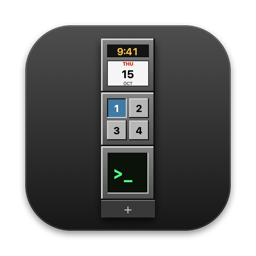
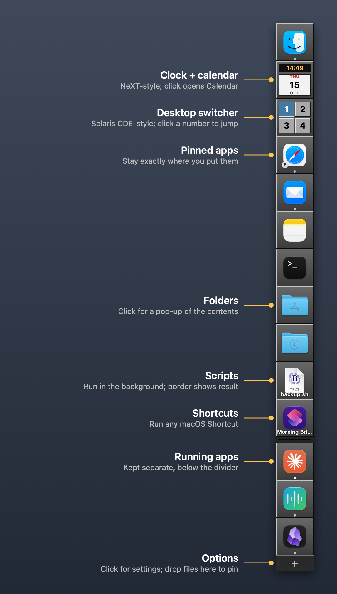

<p align="center"></p>

# NeXTDock
[](https://github.com/kghaynes/nextdock/releases/latest)
[](https://github.com/kghaynes/nextdock/commits/main)
[](#install)
[](main.swift)
[](LICENSE)
[](https://github.com/sponsors/kghaynes)
[](#supporting-nextdock)

A NeXTSTEP-style dock for modern macOS: a fixed column of beveled tiles on the edge of the screen that stays exactly the way you set it up.

It doesn't replace Apple's Dock (that's a protected system app). It runs alongside it, and can push Apple's Dock out of sight while leaving Mission Control and Spaces working.

<p align="center"></p>

## Why

The modern macOS Dock mixes running apps in with pinned ones, shows background apps you can't get rid of, and makes it awkward to pin folders, scripts, or Shortcuts. NeXTDock fixes that:

- **Pinned items never move** unless you move them. Nothing gets added or removed on its own, and dragging a tile out of the dock does nothing, so you can't lose one by accident.
- **Running apps get their own section** below a divider, in launch order.
- **Pin anything**: apps, folders, files, shell/Python/AppleScript scripts, and Shortcuts.
- **Hide any app** from the running section with "Never Show in Dock".
- **Notification badges** for every app, like Apple's Dock: unread Mail, Messages, Slack, and so on.
- **Out of the way when you want**: automatic hide and show, or a quick Hide NeXTDock toggle. It also steps aside for Mission Control.

## What's new in 0.4.0

- **Notification badges.** Apps show the same red badge they show in Apple's Dock (unread counts, "!" or short text), on pinned and running tiles. Numbers over 99 show as 99+. Turn them off with **+ → Show Notification Badges**.
- **Automatically hide and show.** Off by default. Turn it on with **+ → Automatically Hide and Show**. The column slides off the screen edge and leaves a thin strip. Point at the strip to bring it back (choose the wait under **+ → Show After**: none, 0.2, 0.5 or 1 second). It hides again shortly after the pointer leaves, but never while a menu is open, while you're dragging, or while one of NeXTDock's windows is open. Dragging a file to the strip brings the column back so you can pin it.
- **Hide NeXTDock / Show NeXTDock.** A quick toggle in every tile's right-click menu and in the **+** menu (Control-Command-H while one of those menus is open). Click the strip at the screen edge to bring it back. It stays hidden after a restart until you show it again.
- **Mission Control.** The column now hides while Mission Control is open, so it no longer covers the button for adding a desktop, and comes back when Mission Control closes.

## Features

| Tile | What it does |
|---|---|
| App | Click to launch or bring to front. Drop documents on it to open them with that app. |
| Folder | Click for a pop-up menu of its contents (Downloads is sorted newest first). |
| Script | Runs in the background. Border turns yellow while running, then green (success) or red (failure). `.command` files open in Terminal. Drop files on it to pass them in as arguments. Output is logged to `~/Library/Logs/NeXTDock/`. |
| Shortcut | Runs a macOS Shortcut. Drop files on it to use them as input. |
| Clock | NeXT-style live clock and calendar page. Click to open Calendar. |
| Desktops | Solaris CDE-style desktop switcher: one button per desktop, the current one pressed in. Click a number to jump straight to that desktop. |

Other options (click the **+** tile at the bottom): left or right edge, tile size, lock the dock, notification badges, automatically hide and show, hide NeXTDock, launch at login, NeXT-style double-click to launch, NeXT-style running indicator, and hide or restore Apple's Dock.

On the right edge the column can cover desktop icons. If that bothers you, turn on auto-hide or use the left edge.

## Install

Download the latest `NeXTDock-x.y.z.dmg` from [Releases](https://github.com/kghaynes/nextdock/releases), open it, and drag **NeXTDock** into **Applications**. Then open NeXTDock from Applications.

The app is signed with an Apple Developer ID and notarized by Apple, and it runs on both Apple Silicon and Intel Macs (macOS 13 or later).

To start it automatically, click the **+** tile at the bottom of the dock and choose **Launch at Login**.

## Build from source

Requires macOS 13 or later and Xcode or the Command Line Tools (`xcode-select --install`).

```sh
git clone https://github.com/kghaynes/nextdock.git
cd nextdock
./build.sh --install    # builds, copies to /Applications, and launches
```

On first launch it copies whatever is pinned in Apple's Dock so you start from a familiar layout.

### Signing

`build.sh` signs the app with your **Developer ID Application** certificate if you have one, otherwise with a self-signed identity named **NeXTDock Local Signing** if it exists, and falls back to an ad-hoc signature. Always run the copy in `/Applications` (`./build.sh --install`): replacing an app while it's running breaks its signature, and macOS then won't list it in Privacy & Security. A stable identity matters because macOS ties the Accessibility permission (needed by the desktop switcher) to the app's signature. With ad-hoc signing you have to re-grant the permission after every rebuild.

To create the local identity (one time):

```sh
D=$(mktemp -d); cd "$D"
cat > cs.cnf <<'EOF'
[req]
distinguished_name=dn
x509_extensions=ext
prompt=no
[dn]
CN=NeXTDock Local Signing
[ext]
keyUsage=critical,digitalSignature
extendedKeyUsage=critical,codeSigning
basicConstraints=critical,CA:false
EOF
openssl req -x509 -newkey rsa:2048 -nodes -keyout key.pem -out cert.pem -days 3650 -config cs.cnf
openssl pkcs12 -export -inkey key.pem -in cert.pem -out cs.p12 -passout pass:nextdock \
  -name "NeXTDock Local Signing" -keypbe PBE-SHA1-3DES -certpbe PBE-SHA1-3DES -macalg sha1
security import cs.p12 -k ~/Library/Keychains/login.keychain-db -P nextdock -T /usr/bin/codesign
cd - && rm -rf "$D"
```

### Making a release (maintainers)

`release.sh` builds a universal app, signs it with your Developer ID, packages a drag-to-install DMG, sends it to Apple for notarization, and attaches Apple's approval ticket. `./release.sh --publish` also creates the GitHub Release. The version number lives in the `VERSION` file. See the comments at the top of `release.sh` for the one-time setup.

To refresh the README images after a visual change, run `tools/screenshots.sh`. It renders the dock offscreen (`NeXTDock --snapshot`) with a demo layout of standard macOS apps, adds the callouts, and writes `docs/screenshot.png` and `docs/icon.png`.

## Permissions

- Notification badges and auto-hide need no permissions.
- **Accessibility** (only for the desktop switcher): switching desktops works by pressing macOS's built-in "Switch to Desktop N" shortcut (Control-1 through Control-9). NeXTDock turns those shortcuts on for you the first time you use each one.

## Configuration

Settings live in `~/Library/Application Support/NeXTDock/config.json`. It's plain JSON and safe to edit by hand; use **+ → Reload Config** afterward. Optional keys include `spaceNames` (names shown when hovering over desktop buttons):

```json
"spaceNames": ["Main", "Email", "Clients", "Lab"]
```

## Uninstall

```sh
pkill -x NeXTDock
defaults delete com.apple.dock autohide-delay; killall Dock   # only if you hid Apple's Dock
rm -rf ~/Library/Application\ Support/NeXTDock ~/Library/Logs/NeXTDock
```

## Limitations

- Notification badges are read from macOS's own record of each app's Dock badge (an undocumented LaunchServices call). If a future macOS changes it, badges simply stop showing; nothing else is affected.
- The desktop switcher follows the main display's desktops only.
- Moving a window to another desktop by dropping it on a desktop button isn't possible without disabling System Integrity Protection.

## Supporting NeXTDock

NeXTDock is free and open source. There are no ads, no paid tier, and nothing leaves your Mac.

It is built and maintained by one person on his own time. If NeXTDock made your Mac a little less maddening, you can say thanks here:

- **[GitHub Sponsors](https://github.com/sponsors/kghaynes)**: one-time or monthly. No fees, so all of it goes to the project.
- **[Ko-fi](https://ko-fi.com/kenhaynes)**: one-time tip by card or PayPal. No GitHub account needed.

Tips are completely optional and are not tax-deductible. Everything in NeXTDock works the same whether you tip or not.

Not in a position to tip? Starring the repo, opening issues, and telling a fellow NeXT or Solaris veteran about it helps just as much.

## License

MIT. See [LICENSE](LICENSE).
